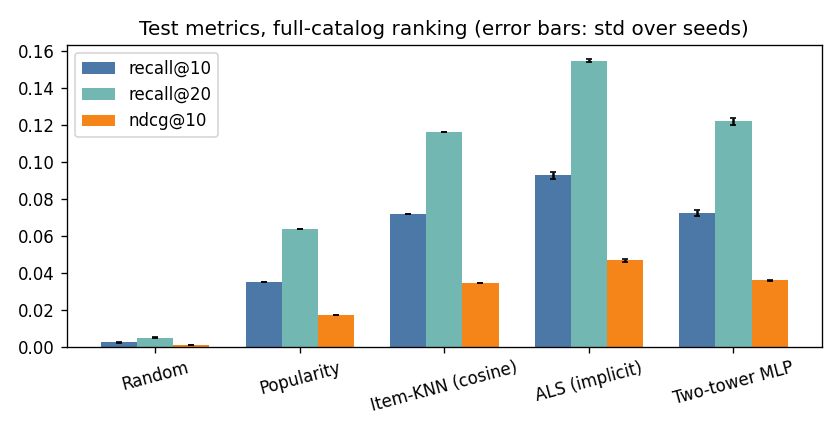
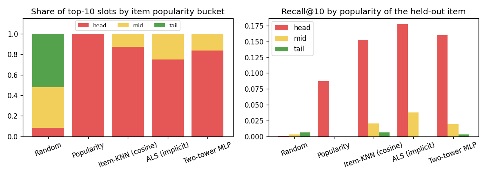
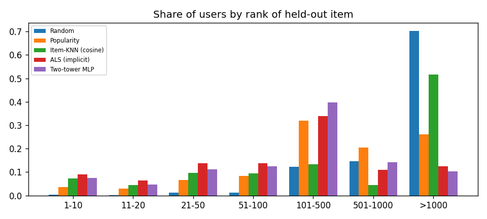

# MovieLens 1M implicit-feedback recommender ladder

An offline comparison of four recommenders on MovieLens 1M, treating every rating as an implicit positive:
popularity, item-KNN (cosine), implicit ALS, and a two-tower MLP in PyTorch. Evaluation ranks the **full item catalog**
for every user (no sampled negatives) after a **temporal leave-last-interaction-out split per user**.
CPU only. Offline metrics only: nothing here says anything about click-through, revenue, or how these models would
behave in a real product.

## Data and license (read this first)

The data is **not in this repository and must not be added to it.** `make data` downloads
`https://files.grouplens.org/datasets/movielens/ml-1m.zip` into the git-ignored `data/` folder and refuses to continue unless
its SHA-256 equals the pin in `src/recsys/data.py` (`a6898adb50b9ca05aa231689da44c217cb524e7ebd39d264c56e2832f2c54e20`; the
MD5 also matches the one GroupLens publishes).

The GroupLens ml-1m README grants use for research purposes only, on these conditions: do not state or imply endorsement by the
University of Minnesota or GroupLens; acknowledge the dataset in publications; do not redistribute the data without separate
permission; no commercial or revenue-bearing use without permission. This project is a personal research/learning
exercise, is not endorsed by GroupLens or the University of Minnesota, and redistributes nothing. The MIT license in
`LICENSE` covers this repository's code only, not the data.

Citation: F. Maxwell Harper and Joseph A. Konstan. 2015. The MovieLens Datasets: History and Context.
*ACM Transactions on Interactive Intelligent Systems* 5, 4, Article 19. https://doi.org/10.1145/2827872

## Reproduce

```bash
make install      # pinned deps; CPU-only torch wheel
make reproduce    # download + verify data, run the full ladder, regenerate figures and the README tables, run tests
```

Seeds are fixed (ALS and two-tower use seeds 0, 1, 2; validation tuning uses seed 0). Reruns on the same machine and package
versions should reproduce the numbers to float precision for the deterministic models; multithreaded BLAS or a different
torch build can shift ALS and two-tower results slightly. Results are written to `results/results.json`; `python -m recsys.report`
rewrites the generated block below from that file only, and a test fails if the README block and `results.json` disagree.
An interrupted run resumes from a git-ignored cache (`results/.cache.json`); delete it for a from-scratch run.

## Protocol

- **Interactions:** every rating (1 to 5) is a positive. Rating values are ignored, so a 1-star rating counts the same as a
  5-star rating. This is a deliberate simplification and a limitation (see below).
- **Split:** per user, interactions are ordered by (timestamp, item id). The last is test, the second to last is validation,
  the rest are train. The item-id tie-break is needed because timestamps have one-second resolution and many ties.
- **Model selection:** hyperparameters are chosen by validation NDCG@10 with train as history. Final models are refit on
  train+validation and scored once on test with train+validation as history. The test set is never used for selection.
- **Ranking:** all catalog items (every item appearing in the ratings file) are scored; the user's history is excluded; ties
  break by lower item index. Recall@K equals HitRate@K because each user has exactly one held-out item.
- **Coverage@K:** distinct items appearing in any user's top-K, divided by catalog size.
- **Popularity bias:** buckets, bucket shares of recommendations, recall by bucket of the held-out item, and exposure Gini.
- **Models:** popularity (train+val counts); item-KNN with cosine similarity on binary data, optional top-k neighbour pruning and
  shrinkage; implicit ALS (Hu, Koren, Volinsky 2008) with exact per-row solves in numpy; two-tower MLP (user-id and item-id
  embeddings, one MLP per tower, dot-product score) trained with a full-catalog softmax over all items.
  A random ranking is included as a sanity floor.

## Tests (leakage-focused)

`pytest` covers: for every user, train < validation < test strictly by (timestamp, item) including tied timestamps; the same on
the real data; splits are disjoint and complete; the split is invariant to input row order; train matrices contain no
validation or test pairs; models fit on train produce identical scores when all validation and test items are replaced with
other items; history items are excluded from rankings and ties are deterministic; metric values against hand calculations;
the models learn a planted block structure; the download checksum check rejects a corrupt file; the README results block equals
the rendering of `results.json`. CI (`.github/workflows/ci.yml`) downloads the data, runs the tests, and runs a small smoke
pipeline with tiny grids. CI does not reproduce the reported numbers.

## Results

All numbers below are generated from `results/results.json`.

<!-- RESULTS:BEGIN (generated by `python -m recsys.report`, do not edit) -->
### Dataset and split (all counts regenerated from the run)

- 6,040 users, 3,706 items, 1,000,209 interactions (density 4.468%). Every rating is treated as an implicit positive.
- Train 988,129 / validation 6,040 (1 per user) / test 6,040 (1 per user).
- Test items never seen in train or validation: 2 (counted as misses, never dropped).
- Dataset SHA-256 pin: `a6898adb50b9ca05aa231689da44c217cb524e7ebd39d264c56e2832f2c54e20`.

### Test results, full-catalog ranking

Mean ± std over seeds (3 seeds for ALS and two-tower, 1 run for the deterministic models). History items are excluded from the ranking; the full catalog is ranked.

| Model | Recall@10 | Recall@20 | NDCG@10 | Coverage@10 | Coverage@20 |
|---|---|---|---|---|---|
| Random | 0.0026 ± 0.0002 | 0.0051 ± 0.0005 | 0.0012 ± 0.0001 | 1.0000 ± 0.0000 | 1.0000 ± 0.0000 |
| Popularity | 0.0353 | 0.0641 | 0.0174 | 0.0534 | 0.0764 |
| Item-KNN (cosine) | 0.0722 | 0.1166 | 0.0349 | 0.2178 | 0.3092 |
| ALS (implicit) | 0.0929 ± 0.0020 | 0.1548 ± 0.0009 | 0.0469 ± 0.0007 | 0.3851 ± 0.0009 | 0.4539 ± 0.0009 |
| Two-tower MLP | 0.0725 ± 0.0014 | 0.1221 ± 0.0020 | 0.0360 ± 0.0004 | 0.4332 ± 0.0282 | 0.5226 ± 0.0279 |

95% bootstrap CIs over users (seed 0 run; this captures user sampling noise, not seed noise):

| Model | Recall@10 | Recall@20 | NDCG@10 |
|---|---|---|---|
| Random | [0.0013, 0.0040] | [0.0030, 0.0063] | [0.0006, 0.0020] |
| Popularity | [0.0310, 0.0402] | [0.0584, 0.0699] | [0.0150, 0.0199] |
| Item-KNN (cosine) | [0.0657, 0.0790] | [0.1084, 0.1248] | [0.0315, 0.0387] |
| ALS (implicit) | [0.0833, 0.0975] | [0.1452, 0.1619] | [0.0421, 0.0503] |
| Two-tower MLP | [0.0677, 0.0813] | [0.1137, 0.1305] | [0.0328, 0.0402] |

Paired bootstrap of per-user NDCG@10 differences (seed 0, 95% CI of the mean difference):

| Comparison | Mean diff | 95% CI | CI excludes 0 |
|---|---|---|---|
| Item-KNN (cosine) − Popularity | +0.0175 | [+0.0137, +0.0214] | yes |
| ALS (implicit) − Popularity | +0.0286 | [+0.0239, +0.0329] | yes |
| Two-tower MLP − Popularity | +0.0190 | [+0.0153, +0.0228] | yes |
| ALS (implicit) − Item-KNN (cosine) | +0.0111 | [+0.0071, +0.0150] | yes |
| Two-tower MLP − Item-KNN (cosine) | +0.0015 | [-0.0024, +0.0057] | no |
| Two-tower MLP − ALS (implicit) | -0.0096 | [-0.0135, -0.0057] | yes |

### Popularity-bias analysis (seed 0)

Items are bucketed by train+validation popularity: head = top 10% of the catalog (370 items), mid = next 40% (1483), tail = bottom 50% (1853).

| Model | Head share of top-10 slots | Mid | Tail | Mean popularity percentile of recs (test items: 0.211) | Exposure Gini@10 |
|---|---|---|---|---|---|
| Random | 0.084 | 0.397 | 0.519 | 0.515 | 0.142 |
| Popularity | 1.000 | 0.000 | 0.000 | 0.003 | 0.993 |
| Item-KNN (cosine) | 0.870 | 0.127 | 0.003 | 0.044 | 0.961 |
| ALS (implicit) | 0.750 | 0.250 | 0.000 | 0.070 | 0.870 |
| Two-tower MLP | 0.835 | 0.162 | 0.003 | 0.054 | 0.911 |

Recall@10 split by the popularity bucket of the held-out item (head items are 40.3% of test targets; a lower percentile means more popular, 0 = most popular item):

| Model | Head targets | Mid targets | Tail targets |
|---|---|---|---|
| Random | 0.0008 (n=2436) | 0.0030 (n=2954) | 0.0062 (n=650) |
| Popularity | 0.0874 (n=2436) | 0.0000 (n=2954) | 0.0000 (n=650) |
| Item-KNN (cosine) | 0.1523 (n=2436) | 0.0206 (n=2954) | 0.0062 (n=650) |
| ALS (implicit) | 0.1778 (n=2436) | 0.0379 (n=2954) | 0.0000 (n=650) |
| Two-tower MLP | 0.1601 (n=2436) | 0.0190 (n=2954) | 0.0031 (n=650) |

### Per-user distribution of the held-out item's rank (seed 0)

Each user has one held-out item, so per-user Recall and NDCG are all-or-nothing at a given cutoff; the distribution that carries information is the rank itself.

| Model | Median rank | 25th pct | 75th pct | Share with NDCG@10 = 0 | 1-10 | 11-20 | 21-50 | 51-100 | 101-500 | 501-1000 | >1000 |
|---|---|---|---|---|---|---|---|---|---|---|---|
| Random | 1700 | 840 | 2618 | 0.998 | 0.002 | 0.002 | 0.012 | 0.012 | 0.123 | 0.147 | 0.702 |
| Popularity | 440 | 129 | 1034 | 0.965 | 0.035 | 0.029 | 0.065 | 0.084 | 0.319 | 0.206 | 0.262 |
| Item-KNN (cosine) | 1151 | 67 | 2662 | 0.928 | 0.072 | 0.044 | 0.095 | 0.095 | 0.134 | 0.044 | 0.516 |
| ALS (implicit) | 141 | 40 | 458 | 0.910 | 0.090 | 0.063 | 0.137 | 0.137 | 0.338 | 0.109 | 0.125 |
| Two-tower MLP | 186 | 57 | 495 | 0.926 | 0.074 | 0.048 | 0.111 | 0.125 | 0.397 | 0.143 | 0.103 |

(Columns after the first five are the share of users whose held-out item lands in that rank range.)

### Selected hyperparameters (chosen on validation NDCG@10, seed 0)

- Item-KNN: `{'k': 5, 'shrink': 0.0}` (16 configs tried)
- ALS: `{'factors': 128, 'alpha': 0.5, 'reg': 10.0, 'iters': 15}` (30 configs tried)
- Two-tower: `{'dim': 64, 'hidden': 128, 'dropout': 0.2, 'best_epoch': 10}` (3 configs tried, max 12 epochs, best epoch by validation reused for the final fit)

### Compute (CPU only)

- 1 CPU core(s), PyTorch 2.14.1+cpu on CPU with 1 thread, Python 3.10.12, numpy 2.2.6, scipy 1.15.3, pandas 2.3.3.
- Summed single-core compute for the whole pipeline: about 73 minutes (tuning 54 min: KNN 0.6, ALS 21.4, two-tower 31.9; final fits and evaluation 19 min). The run was resumed from a cache after sandbox restarts, so these are per-step sums, not one continuous wall-clock.
- No GPU, no paid compute.






<!-- RESULTS:END -->

## What the results do and do not show

Statements here are checked against `results/results.json` by `tests/test_claims.py`.

- ALS has the highest Recall@10, Recall@20 and NDCG@10 of the four models, and the paired bootstrap CIs for NDCG@10 against
  item-KNN and the two-tower exclude zero. The two-tower and item-KNN are not distinguishable on NDCG@10 in this setup (the
  paired CI includes zero). Every learned model beats popularity.
- Every model's recommendations are dominated by the most popular 10% of items, and recall on held-out tail items is close to
  zero for all models (the tail bucket holds few test targets, so that column is noisy). The coverage column should be read with this in mind: higher coverage
  here does not mean better recommendations, and the random ranking has the highest coverage and the worst accuracy.
- Item-KNN's median held-out rank is worse than popularity's even though its Recall@10 is higher. The selected configuration
  keeps only a handful of neighbours per item, which leaves many catalog items tied at a score of zero for a user; ties are
  broken by item index. We did not investigate this further. Hyperparameters were selected for NDCG@10, so models are tuned for
  the head of the ranking, not for the full rank distribution.
- The ALS search ended at the low edge of the confidence (`alpha`) grid and the larger factor sizes were close to each other;
  the validation differences between the top few ALS configurations are small. The two-tower search was small (3 configs,
  12 epochs max) and was not tuned as thoroughly as ALS, so the ordering of ALS over the two-tower reflects this setup and
  tuning effort, not a general ranking of the model families.

## Limitations

- **One held-out item per user.** Metrics rest on a single interaction per user (6,040 test events), so confidence intervals are wide
  relative to the gaps between the closer models. Seed variation is shown only for ALS and two-tower.
- **Per-user temporal split, not a global cut-off.** A user's test interaction can be earlier in calendar time than other users'
  training interactions, so the split prevents future leakage within each user's history but not across users. A global
  time split would be stricter.
- **Ratings as implicit feedback.** A rating is not a view or click log: MovieLens users chose what to rate, and rating values are
  discarded here. The "last interaction" is the last rated movie, and MovieLens 1M timestamps often reflect a rating session
  rather than watch order. Many ratings were entered in bulk when users joined.
- **Held-out items that are not in train.** Two test items never appear in train or validation and count as misses.
- **Small, old, single dataset.** MovieLens 1M (users who joined in 2000). No claim is made about other datasets, other splits,
  or newer models. These are not tuned state-of-the-art baselines and nothing here is production-ready.
- **Full softmax two-tower.** The two-tower treats all non-target items, including the user's other positives, as negatives during
  training. It has no item or user features, only ids, so it cannot handle cold-start users or items.
- **Compute budget.** Everything ran on 1 CPU core. The grids were sized to that budget, which is why the search is modest.
- **Offline metrics only.** No online A/B, no CTR, no business metric.

## AI assistance disclosure

This repository was built with AI assistance (an AI coding agent wrote and ran the code and drafted this README under the
direction of the repository owner). All numbers in this file come from `results/results.json`, which is produced by the code in
`src/`; the owner is responsible for reviewing the code and claims before relying on them.

## Layout

```
src/recsys/   data.py (download + checksum), split.py, metrics.py, models.py, experiment.py, report.py
tests/        leakage, metrics, models, data-pin, README-vs-results and claims tests
results/      results.json plus figures (generated)
```
